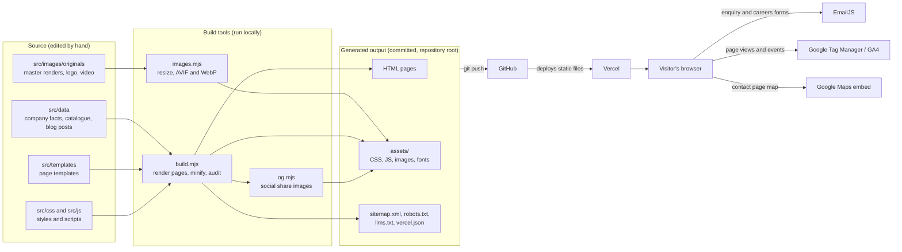
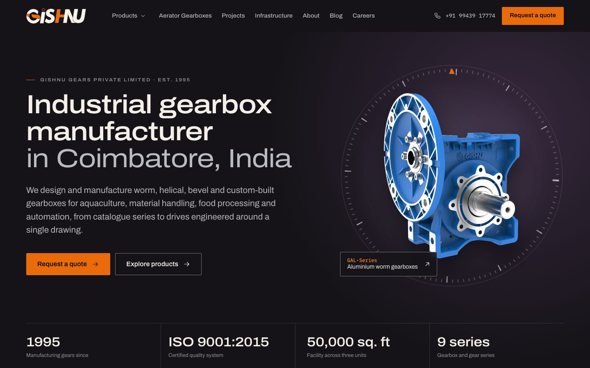
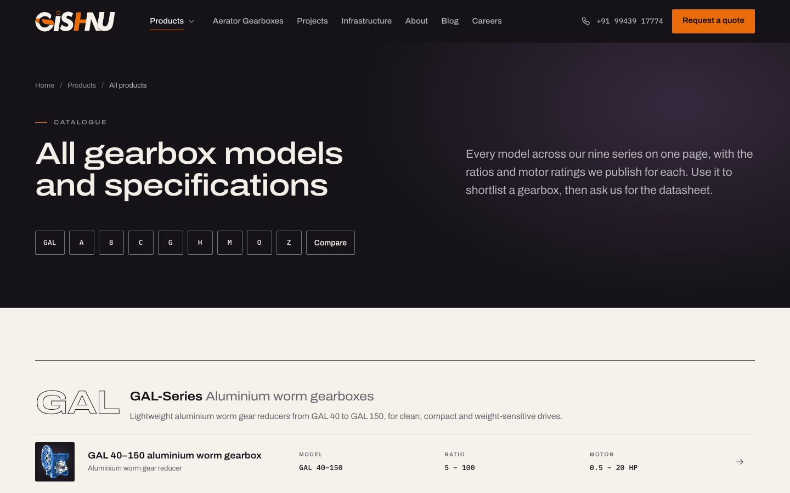
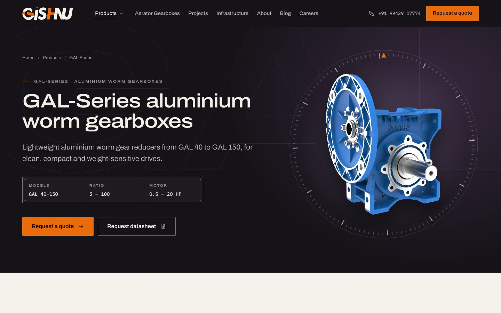
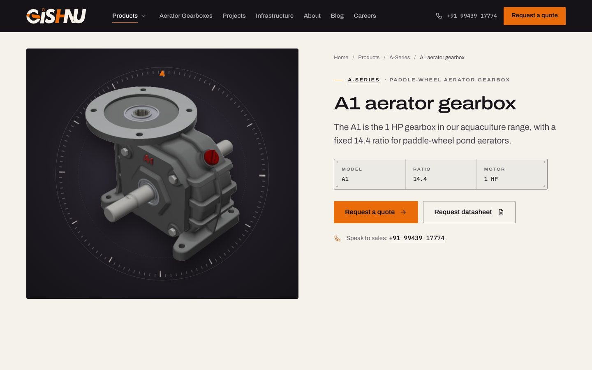
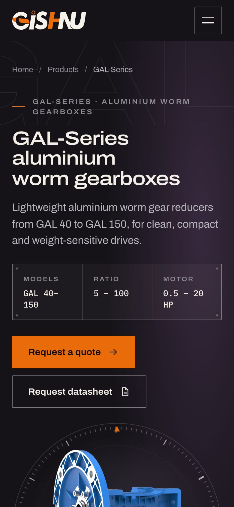

# gishnugears.com

Website of Gishnu Gears Private Limited, an industrial gearbox manufacturer in Coimbatore, India. A static site: plain HTML, one CSS file and a few small JavaScript modules, generated by a small Node.js build and hosted on Vercel.

Live site: https://www.gishnugears.com/

**Contents:** [Features](#features) · [Architecture diagram](#architecture-diagram) · [Screenshots](#screenshots) · [Setup guide](#setup-guide) · [How it is organised](#how-it-is-organised) · [Things to know](#things-to-know) · [Future improvements](#future-improvements) · [Lessons learned](#lessons-learned)

## Features

- **39 pages** generated from one content source: home, about, products hub, full catalogue, aerator gearboxes, 9 series pages, 13 product pages, projects, infrastructure, careers, blog with 4 articles, contact, privacy policy and a 404 page.
- **Original product renders throughout.** The 24 existing renders are reused unchanged and served as AVIF and WebP at several sizes, with width and height set so the layout does not shift.
- **On-page SEO on every page:** unique title, description and primary keyword, canonical URL, one `<h1>`, breadcrumbs, Open Graph and Twitter tags, and a generated 1200×630 social image.
- **Structured data (JSON-LD):** Organization and LocalBusiness, WebSite, WebPage, BreadcrumbList, Product, BlogPosting, ContactPage and FAQPage where they apply. No prices, ratings or reviews are claimed.
- **Crawl files generated by the build:** `sitemap.xml` with image entries, `robots.txt`, `llms.txt` and `llms-full.txt`.
- **35 permanent redirects** from the old site's URLs, in `vercel.json`.
- **Enquiry and careers forms** with inline validation, a spam honeypot and success and error messages, sent through the existing EmailJS service.
- **Small and fast:** about 60 kB of CSS and 3 kB of core JavaScript, with the product showcase, forms and menu code loaded only when needed. Fonts are self-hosted.
- **Accessible:** keyboard-operable menus, tabs and gallery, visible focus, reduced-motion support and 44 px touch targets. axe-core reports no violations.
- **A build that refuses to ship mistakes:** it stops on duplicate titles, descriptions or keywords, a missing or extra `<h1>`, skipped heading levels, images without `alt` or dimensions, broken internal links and invalid structured data.

Test results and the list of content questions still open with the client are in [docs/SEO-AUDIT.md](docs/SEO-AUDIT.md). The keyword assigned to each page is in [docs/KEYWORD-MAP.md](docs/KEYWORD-MAP.md).

## Architecture diagram



There is no server-side code and no build step on Vercel. The build runs on a developer's machine and its output is committed, so what is in the repository is exactly what is served.

## Screenshots

| Home | All products |
|---|---|
|  |  |

| Series page | Product page |
|---|---|
|  |  |

| Contact | Mobile |
|---|---|
|  |   |

## Setup guide

Requires Node.js 20 or newer.

```bash
git clone <repository url>
cd <repository folder>/tools
npm install        # first time only
npm run build      # regenerates every page, the sitemap, robots.txt, llms.txt and vercel.json
npm run serve      # preview at http://localhost:4173 (behaves like Vercel: redirects, 404 page)
```

Then commit **both** the source change and the regenerated files, and push. Vercel deploys the repository as static files; there is no build step on Vercel.

The build stops with an error if it finds a duplicate title or description, a page without exactly one `<h1>`, a skipped heading level, an image without `alt` or dimensions, a broken internal link or invalid structured data.

### Common tasks

| To… | Edit | Then run |
|---|---|---|
| Change the phone number, address or social links | `src/data/site.mjs` | `npm run build` |
| Add or edit a product or series | `src/data/catalog.mjs` | `npm run build && npm run og` |
| Publish a blog article | Add an entry to `src/data/posts.mjs` | `npm run build && npm run og` |
| Add a product image | Put a transparent PNG in `src/images/originals/products/` | `npm run images && npm run build` |
| Change page copy or layout | `src/templates/*.mjs` | `npm run build` |
| Change styling | `src/css/*.css` | `npm run build` |

New pages are added to `sitemap.xml`, `llms.txt` and `docs/KEYWORD-MAP.md` automatically.

`npm run og` regenerates the social share images in `assets/og/` and needs Google Chrome installed (or `CHROME_PATH` pointing at a Chromium binary). `npm run images` needs `ffmpeg` only for the video poster frames.

## How it is organised

| Path | What it is |
|---|---|
| `index.html`, `about-us/`, `products/`, `series/`, `blog/` … | **Generated pages.** This is what Vercel serves. Do not edit by hand. |
| `assets/` | Generated CSS/JS (fingerprinted), optimised images, fonts, video, social images. |
| `sitemap.xml`, `robots.txt`, `llms.txt`, `llms-full.txt`, `vercel.json` | Generated crawl and hosting files. |
| `src/data/` | **Content.** Company facts, product catalogue, blog articles. |
| `src/templates/` | Page templates (plain JavaScript template strings). |
| `src/css/`, `src/js/` | Styles and scripts, before minification. |
| `src/images/originals/` | Untouched master images, logo and video. |
| `tools/` | Build scripts. |
| `docs/` | SEO audit report, keyword map and the screenshots above. |

`src/`, `tools/`, `docs/` and this README are excluded from the deployment by `.vercelignore`.

## Things to know

- **Product images are never altered.** The pipeline trims empty transparent margin, resizes and converts to AVIF/WebP. Colours and proportions are untouched.
- **Forms** post to the existing EmailJS service (`service_xw8ufxt`, template `template_cn322ae`) with the original field names. The ids live in `src/data/site.mjs`.
- **Analytics.** The original containers (GTM `GTM-5LR7RMVW`, GA4 `G-LVZ0ERHB04`) load only on `gishnugears.com`, after the page has loaded, so local previews and Vercel preview URLs do not send hits through them. The additional Google tag `GTM-5QV3WRM3` (added November 2026) is inserted in the `<head>` of every page exactly as supplied: it loads immediately and on every hostname, including previews. All three ids live in `src/data/site.mjs`; the markup is in `analytics()` in `src/templates/layout.mjs`.
- **Footer credit** ("Designed, developed & managed by Velozity Global Solutions") is `credit` in `src/data/site.mjs`.
- **Redirects** from every old URL are in `vercel.json`, generated from `tools/build.mjs`. If you rename a page, add the old path there. They apply on Vercel only; another host such as Netlify ignores this file and would need its own redirect rules.
- **File names are case-sensitive on Vercel.** `/infrastructure/` and `/Infrastructure/` are different URLs there, even though macOS treats them as the same folder.
- **Do not publish** specifications, certifications or customer names that the company has not confirmed. See the open questions in `docs/SEO-AUDIT.md`.

## Future improvements

- **Rotatable 3D product views.** The renders are flat images. With the CAD file of a gearbox (STEP or SolidWorks) it can be converted to a web 3D model that visitors rotate and zoom; with a set of turntable renders it can be a 360° spin instead.
- **Datasheet downloads.** The catalogue PDFs linked from the old site no longer exist, so the buttons currently open the enquiry form. Add the PDFs when the company supplies them.
- **Real factory and team photography** for the infrastructure and about pages.
- **One analytics setup.** Two Tag Manager containers and a direct GA4 tag now load side by side. Consolidate them into one container once it is confirmed which one the company uses, and check that page views are not counted twice.
- **Content-Security-Policy header** once the tags inside the Tag Manager containers are known.
- **Job listings with structured data** when the company has specific vacancies to advertise.
- **A published email address and opening hours** on the contact page and in the structured data, when the company confirms them.

## Lessons learned

- **Keep master assets in the repository.** Four product renders existed only as links to an old deployment on another domain. They had to be recovered before that deployment disappears, and they now live in `src/images/originals/`.
- **macOS hides file-name case problems.** Renaming `Infrastructure/` to `infrastructure/` looked finished locally, but git still recorded the old capitalised path, which would have returned a 404 on Vercel. Check `git status` for case-only renames before pushing.
- **Guard analytics by hostname.** A test run on `localhost` was able to send a page view to the live GA4 property. The original tags are now limited to the production domain, and automated tests block Google and EmailJS requests.
- **Let the build enforce SEO rules.** Duplicate titles and skipped heading levels crept in more than once while pages were being written. Failing the build on them was more reliable than reviewing 39 pages by hand.
- **Do not fill gaps with invented content.** Where the old site had contradictory specifications or claims that could not be verified, the page says less and the question is listed for the client in `docs/SEO-AUDIT.md`.
- **Redirect rules are tied to the host.** The site was previewed on Netlify for approval, where `vercel.json` has no effect, so old URLs can only be tested on a Vercel deployment.
